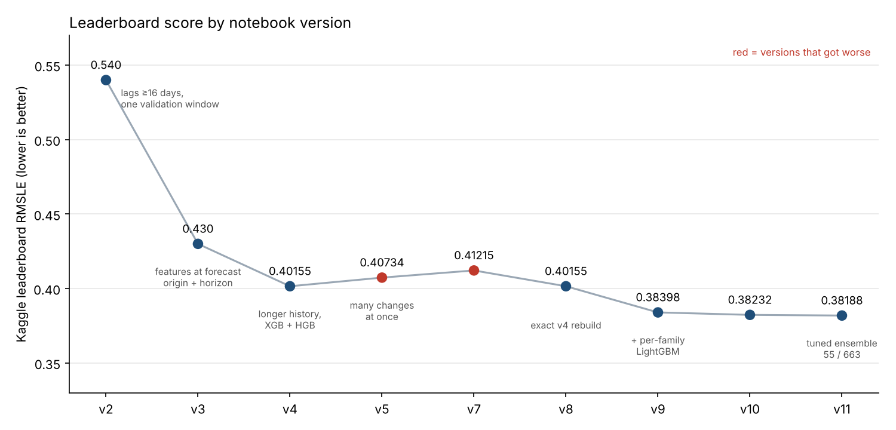
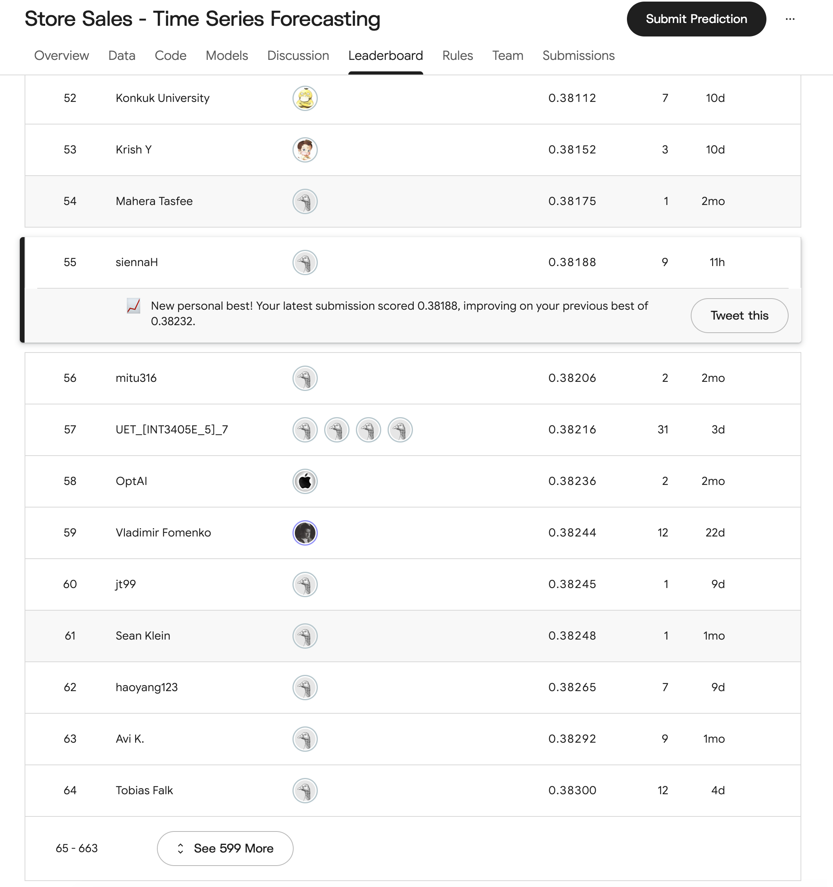

# Store Sales – Time Series Forecasting

Independent Kaggle project: forecast 16 days of daily sales for every store and product family of Corporación Favorita, a grocery chain in Ecuador.

| | |
|---|---|
| **Best leaderboard RMSLE** | **0.38188** |
| **Rank** | **55 / 663 active teams (Top 8.3%, Nov 2026)** |
| **Improvement** | 0.540 → 0.382 over 11 notebook versions |
| **Tools** | Python, pandas, NumPy, scikit-learn, XGBoost, LightGBM, matplotlib |





---

## Problem

- **Task:** predict daily sales for 1,782 series (54 stores × 33 product families) from Aug 16 to Aug 31, 2017.
- **Metric:** RMSLE. Models are trained on `log1p(sales)`, so RMSE on that scale equals RMSLE.
- **Data:** 3.0M daily sales rows (Jan 2013 – Aug 15, 2017), promotions, store information, holidays and events, oil prices, and daily store transactions.

Raw competition data is not included in this repository because the competition rules do not allow redistributing it. It can be downloaded from the [Kaggle competition page](https://www.kaggle.com/competitions/store-sales-time-series-forecasting/data).

## What I found in the data

- Stores differ a lot: the largest store sells about 23× more than the smallest on average.
- About 31% of rows have zero sales. Small families like Books and Baby Care have zero sales on most days.
- Almost every store is closed on Jan 1, and Dec 25 is missing from the data entirely.
- Eight stores opened during the training period, so they have only zeros before their opening date.
- The April 2016 earthquake caused unusual sales for several weeks.

## Data cleaning

- For Model B, Jan 1 closures and the missing Dec 25 dates are filled by interpolation, so store closures are not treated as low demand.
- For Model A, training origins that overlap the April 2016 earthquake weeks are skipped.
- A series with no sales in the recent past (28 days for Model A, 21 days for Model B) is forecast as 0.

## Validation

The test period starts the day after the last training date, so validation copies that setup: pick a past forecast start date (the "origin"), use only data up to that date, and score the next 16 days.

- **Main hold-out:** origin Jul 25, 2017, which predicts Jul 26 – Aug 10. It falls on the same weekday as the real test origin.
- Earlier versions also used three rolling folds and the same window in 2016.

This mattered more than any model change. My first version (v2) scored 0.40 locally but 0.54 on the leaderboard, because its validation did not match the real forecasting setup. Rebuilding the validation around forecast origins (v3) brought the leaderboard score to 0.43.

## Models

**Baseline.** The mean of the last 7 days scores 0.531 on the hold-out. Earlier versions also tested a 14-day mean, the same weekday last week, and the same-weekday mean over 4 weeks.

**Model A – direct multi-horizon gradient boosting**
- One global model predicts all 16 days at once. Each row is (series, origin, horizon 1–16).
- Features are computed at the origin:
  - recent means and volatility, same-weekday averages, and days since the last sale;
  - last year's sales around the same dates;
  - promotions on the target day;
  - holidays;
  - store type and cluster.
- Trained on 64 past origins: 1.85M rows and 29 features.
- Final model: 25% HistGradientBoosting + 75% XGBoost.

**Model B – per-family recursive LightGBM ensemble**
- One LightGBM model per product family (33 models), trained across all 54 stores.
- It predicts one day ahead, then feeds that prediction back in as a lag. This repeats 16 times.
- Inputs:
  - daily sales lags;
  - promotions over the 14 days before the target day, plus 7- and 28-day averages;
  - store-level holidays and calendar features;
  - oil price and its moving averages;
  - transactions lagged 16–23 days;
  - store attributes.
- Seven model settings are averaged, combining different look-back lengths (7 to 730 days) and training windows (all history vs. 2015 onward).
- The approach is adapted from public Kaggle notebooks (see Credits). I re-implemented it in NumPy + LightGBM without the Darts library, and chose the ensemble members myself based on hold-out results.

**Blend.** The final forecast is 30% Model A + 70% Model B, averaged in log space. The weight was chosen on the hold-out, not on the leaderboard.

## Results

Hold-out (Jul 26 – Aug 10, 2017):

| Model | RMSLE |
|---|---:|
| Last 7-day mean baseline | 0.5311 |
| Model A (direct) | 0.4030 |
| Model B (7-model ensemble) | 0.3934 |
| **Blend (30 / 70)** | **0.3920** |

Leaderboard by version:

| Version | Main change | Leaderboard RMSLE |
|---|---|---:|
| v2 | lag features ≥ 16 days, one validation window | 0.540 |
| v3 | features at the forecast origin + horizon, time-based CV | 0.430 |
| v4 | longer history (from Aug 2015), XGBoost + HGB blend | 0.40155 |
| v5 / v7 | several changes at once | 0.40734 / 0.41215 |
| v8 | exact rebuild of v4 to confirm the pipeline is reproducible | 0.40155 |
| v9 | + Model B (per-family recursive LightGBM) | 0.38398 |
| v10 | Model B becomes an ensemble, closures cleaned | 0.38232 |
| **v11** | ensemble members re-chosen from hold-out results | **0.38188** |

## Error analysis

The hardest families on the hold-out were mostly low-volume or seasonal:

| Family | Model A | Model B | Blend |
|---|---:|---:|---:|
| School and Office Supplies | 0.807 | 0.702 | 0.722 |
| Lingerie | 0.609 | 0.623 | 0.615 |
| Grocery II | 0.580 | 0.563 | 0.563 |
| Hardware | 0.532 | 0.539 | 0.534 |
| Celebration | 0.535 | 0.533 | 0.531 |

School and Office Supplies is the clearest case. Back-to-school season in August makes sales jump, and the recursive model (B) follows that jump much better than the direct model (A).

## What I learned

1. **Validation design matters more than model choice.** The biggest single gain (0.54 → 0.43) came from fixing validation, not from a new model.
2. **Change one thing at a time.** v5 and v7 changed several things at once and got worse, and I could not tell why. After that, I rebuilt v4 exactly (v8) and tested changes one by one.
3. **More history is not always better.** In Model B with a 365-day look-back, training from 2015 onward scored 0.3960 on the hold-out, compared with 0.3983 using the full history.
4. **Two different model types blend well.** The direct and recursive models make different mistakes, so the blend beats both.

## How to run

1. Open the notebook on Kaggle and add the competition data with **Add Input**.
2. Run all cells. It takes about 70 minutes on the free CPU and needs no internet.
3. Output files:
   - `submission.csv` (the blend);
   - `sub_B_only.csv`;
   - `sub_blend_B085.csv`.

```
kaggle-store-sales-forecasting/
├── README.md
├── store_sales_forecasting.ipynb
└── images/
    ├── version_history.png
    └── leaderboard.png
```

## Credits

Model B's structure (per-family LightGBM, covariate windows, closure cleaning, multi-lag ensemble) is adapted from these public Kaggle notebooks:

- Ferdinand Berr – Darts forecasting notebook
- Chong Zhen Jie – Darts + LightGBM notebook
- Dmitry Shekhov – Darts ensemble with LightGBM

Model A, the validation design, the adaptation and re-implementation decisions, ensemble member selection, blend selection, and error analysis are my own work.
